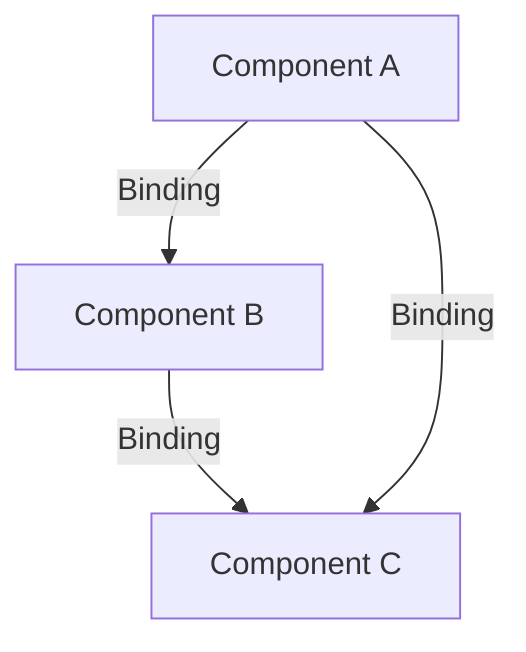

# System Patterns

## Architecture Overview

The ALX_js system follows a component-based architecture with a binding mechanism to connect components together. Components can be bound based on their port types, creating a directed graph of data flow.



## Core Components

### BindingManager

The BindingManager is a singleton responsible for managing components and their bindings. It provides:

- Component registration and retrieval
- Binding creation and validation
- Graph generation and traversal

### GraphManager

The GraphManager works alongside the BindingManager to:

- Create visual binding graphs
- Perform traversals with cycle detection
- Expand special binding configurations
- Validate port compatibility

### BaseComponent

All visual components extend BaseComponent, which includes:

- Multiple portGroup support
- Port registration and management
- Binding helpers

## Data Flow Architecture

The system uses a directed graph portGroupl for data flow:

```
ComponentA (source) -- binding --> ComponentB (target)
```

Each binding connects a source port to a target port, with compatibility determined by port types.

## Binding Mechanism

Bindings are created between component ports, with these key features:

1. **Type Compatibility**: Ports must have compatible types (e.g., X can bind to X1 or X2)
2. **portGroup-based**: Components can have multiple portGroups with different port groupings
3. **Wildcard Support**: Special MiscPortType.ALL port type can connect to all compatible ports
4. **Expansion Logic**: Special bindings are expanded into concrete compatible bindings during graph traversal

## Port Type System

The system uses a hierarchical port type system:

- **ChannelType**: Visual encoding channels (x, y, color, etc.)
- **DataPortType**: Data-related ports (data, field, etc.)
- **MarkPortType**: Mark-related ports (markName, markType)
- **InteractionPortType**: Interaction-related ports (selection, filter)
- **MiscPortType**: Other special port types, including MiscPortType.ALL for wildcard connections

## Graph Traversal

Graph traversal follows these patterns:

1. Start from a root component
2. Traverse all bindings, collecting nodes and edges
3. Handle cycles by tracking visited components
4. Expand special bindings as needed during traversal

## Component portGroups

Components support multiple operational portGroups:

- Each portGroup represents a specific functionality configuration
- portGroups have unique IDs (e.g., "default", "edit", "view")
- Each portGroup defines a specific set of available ports
- Components can switch between portGroups as needed
- Bindings reference both a component and its specific portGroup 

## Component Configuration Management

Components in the system use a centralized configuration management system that separates configuration values from component bindings. This is implemented through:

1. ConfigurationManager (Singleton)
   - Manages configuration values for all components
   - Hierarchical storage: componentId -> portGroup -> portName -> value
   - Provides methods for adding, getting, and clearing configurations

2. BaseChart Configuration Processing
   - Standard processing of chart properties (data, dimensions, fields)
   - Configuration groups:
     - data: values
     - dimensions: width, height
     - fields: x, y
     - aesthetics: color, size, fill, stroke

3. Component Structure Pattern
   ```typescript
   // 1. Initial State
   const initState = {...};
   
   // 2. State Reference
   const stateRef = createBaseState(initState);
   
   // 3. Port Groups
   const portGroup = {...};
   
   // 4. Port Configurations
   const portConfigurations: PortConfiguration[] = [...];
   
   // 5. Driver
   const driver: StateDriver<typeof initState> = {...};
   
   // 6. Component Class
   export class MyComponent extends BaseComponent {
       constructor(props: ComponentConfig) {
           super(props);
           this.processConfigurations(props);
       }
   }
   ```

## Configuration vs Bindings

- Configurations: Simple values that configure component behavior
  - Stored in ConfigurationManager
  - Accessed during compilation
  - Examples: dimensions, colors, field names

- Bindings: Connections between components
  - Managed by BindingManager
  - Represent component relationships
  - Examples: drag-to-rect connections, chart-to-selection links

## Chart Component Pattern

Charts follow a standard pattern for processing inputs:
1. Base configuration through BaseChart
2. Component-specific configuration in constructor
3. Configuration access in compile method
4. Default values from initial state 